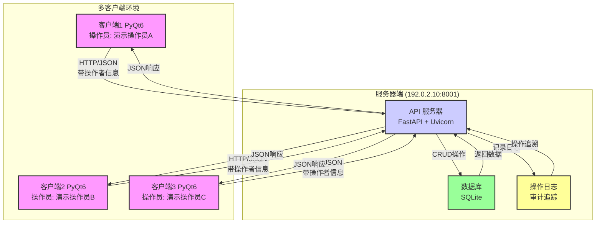
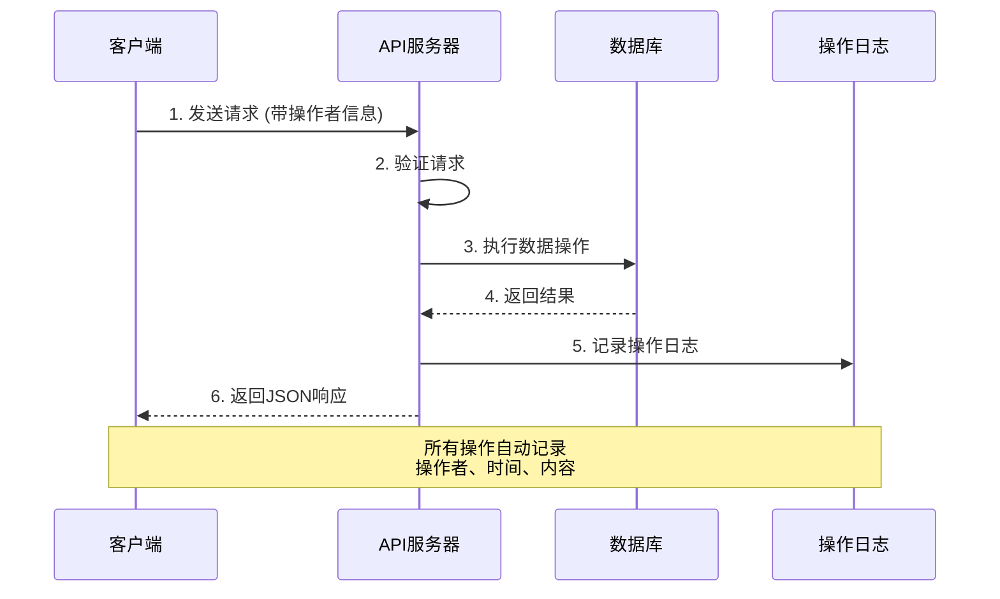
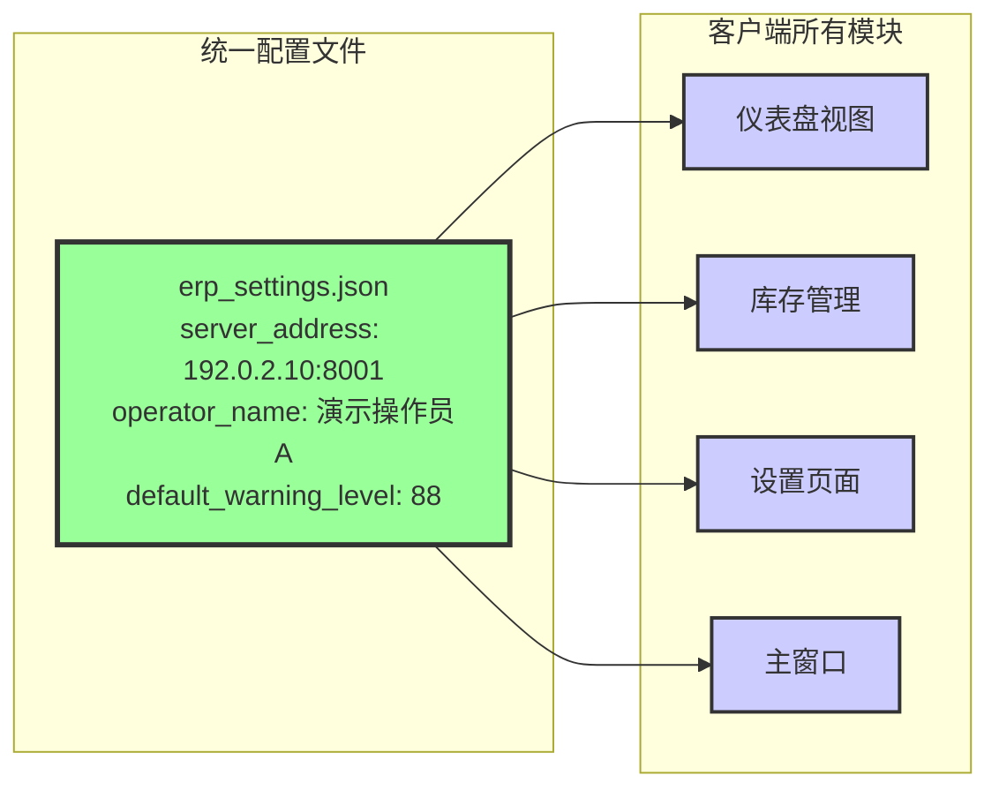

# SimpleStock 库存管理系统 v2.0.2

> 纯C/S架构的企业级库存管理解决方案

A client/server inventory management desktop app for small businesses, built with PyQt6 and FastAPI, covering products, inventory, sales, shipments, analytics, and auditable operation logs.

[](https://www.python.org/)
[](https://fastapi.tiangolo.com/)
[](https://www.riverbankcomputing.com/software/pyqt/)
[]()
[]()
[]()

## 版本记录：v2.0.2（2025-10-16）

### 关键修复
- 🐛 **修复运输状态崩溃问题**：数据库状态值大小写不匹配导致删除运输记录时程序崩溃
- 🔧 **修复127.0.0.1请求问题**：统一配置系统，所有请求使用配置的服务器IP，支持网络部署
- ✨ **统一预警值显示**：仪表盘、库存管理、设置页面预警值完全一致，改用本地配置
- 📦 **优化打包程序**：修复后的版本可正常发布给团队使用

### v2.0.1 (2025-10-12)
- ✨ 统一API服务器为单一文件，简化部署
- 🔧 数据库优化：清理冗余字段，性能提升
- 📚 完善文档：新增多人协作指南和代码检查报告
- 🏗️ 架构优化：移除单机模式，纯C/S架构更安全
- 🐛 修复：更新模型定义，修正错误提示

👉 详细变更请查看 [版本历史](#版本历史)  
👉 v2.0.2 修复详情请查看 [今日修复总结](今日修复总结_20251016.md)

---
## 📋 项目简介

SimpleStock 是一个专为中小企业设计的库存管理系统，采用**纯C/S架构**，实现了客户端与数据库的完全隔离。所有数据操作通过API服务器完成，确保数据安全、操作可追溯。

### 核心特性

✅ **纯C/S架构** - 客户端完全隔离数据库访问，数据安全可控  
✅ **操作追踪** - 100%记录操作者和操作时间，责任可追溯  
✅ **多客户端支持** - 支持多台电脑同时使用，实时数据同步  
✅ **RESTful API** - 标准化的数据接口，易于集成扩展  
✅ **自动化文档** - Swagger UI交互式API文档，开发调试便捷  
✅ **数据安全** - 服务器端统一权限控制，防止数据泄露  
✅ **易于扩展** - 清晰的架构分层，便于功能增强  
✅ **操作审计** - 完整的操作日志追溯，问题排查高效  
✅ **配置统一** - 客户端统一配置管理，部署简单快捷  
✅ **自动库存** - 销售订单自动扣减库存，数据准确无误  

### 适用场景

- 📦 **中小企业仓库管理** - 多人协作，实时同步
- 🏪 **零售门店** - 销售、库存一体化管理
- 🏭 **生产企业** - 原材料和成品库存跟踪
- 🚚 **物流配送** - 发货、在途库存管理
- 📊 **数据分析** - 销售和库存统计报表  

### 技术栈

- **后端**: FastAPI + SQLAlchemy + SQLite
- **前端**: PyQt6
- **通信**: HTTP/JSON + requests
- **数据处理**: Pandas
- **项目语言**: Python 3.8+

## 🏗️ 系统架构与数据流

### 整体架构图



### 数据流转详解



### 配置统一架构 (v2.0.2新增)



## � 系统截图

> 截图将在后续版本中添加

### 主要界面
- 仪表盘：实时库存概况和预警提示
- 产品管理：产品树形视图，支持批量操作
- 库存管理：入库/出库操作，库存日志
- 销售管理：订单导入，销售统计
- 发货管理：物流跟踪，在途库存

---

## �🚀 快速开始 (Getting Started)

### 1. 环境准备
- 确保已安装 Python 3.8+。
- 建议使用虚拟环境以隔离项目依赖。

### 2. 安装依赖
打开终端，运行以下命令：
```bash
pip install -r requirements.txt
```

### 3. 初始化数据库
此操作将创建数据库文件 `database.db` 和所有必需的表结构。
```bash
python database/init_db.py
```

### 4. 启动应用
本项目为**纯C/S架构**，需要分别启动**服务端**和**客户端**。

#### 启动服务端
双击运行 `启动服务端.bat`。
- 此脚本会启动FastAPI服务器，监听 `8001` 端口。
- 启动后请勿关闭此窗口。
- **注意**: 服务端应该只在一台电脑上运行（作为数据中心）

#### 启动客户端
双击运行 `启动客户端.bat`。
- 此脚本会启动PyQt6图形化界面。
- 客户端会根据 `config.ini` 配置连接到服务端。
- **可以在多台电脑上运行**，实现多用户协作。

#### 配置客户端连接
编辑 `config.ini` 文件：
```ini
[Server]
host_ip = 192.0.2.10  # 文档示例（TEST-NET 网段），请改为你的服务器IP
port = 8001            # API端口（默认8001）
operator_name = 演示操作员A    # 改为使用者的姓名
```

### 5. 连接测试 (可选)
如果你需要测试客户端与远程服务器的连接，可以使用 `test_connect_enhanced.bat`。
1. 确保服务端在目标机器上已运行。
2. 运行 `test_connect_enhanced.bat`。
3. 输入服务器的IP地址，然后按回车。
4. 脚本会自动测试网络、端口和所有核心API的连通性。

## ⚙️ 系统功能模块

### 1. 产品管理模块

#### 1.1 产品结构
- 父产品：包含基本产品信息和预警阈值
- 子SKU：具体的产品变体，包含规格和成本价格

#### 1.2 功能特性
- 新增/编辑/删除产品
- 批量导入产品数据(支持CSV/Excel)
- 导出产品数据
- 支持产品规格标准化
- 成本价格管理
- 库存预警设置

### 2. 库存管理模块

#### 2.1 功能特性
- 入库/出库操作
- 库存变动日志记录
- 批量导入库存数据
- 实时库存统计
- 库存预警提醒
- 操作日志追踪

### 3. 销售管理模块

#### 3.1 功能特性
- 销售订单导入
- 销售记录管理
- 库存自动扣减
- 销售统计分析
- 多规格订单支持

### 4. 发货管理模块

#### 4.1 功能特性
- 发货记录管理
- 物流追踪
- 批量发货处理
- 发货状态更新
- 发货统计报表

## 数据库结构

### 核心表结构

#### 1. Product (产品表)
```sql
CREATE TABLE product (
    id INTEGER PRIMARY KEY AUTOINCREMENT,
    parent_sku VARCHAR(50) UNIQUE,  -- 父SKU，唯一标识
    name VARCHAR(100),              -- 产品名称（已废弃，允许NULL）
    warning_threshold INTEGER,       -- 库存预警阈值（已废弃，改为系统设置）
    created_at DATETIME,            -- 创建时间
    updated_at DATETIME             -- 更新时间
);
```

> **注意**: 从 v2.0.1 开始，`name` 和 `warning_threshold` 字段已不再使用：
> - `name` 字段：产品识别完全依赖 `parent_sku`
> - `warning_threshold`：预警阈值改为在系统设置中统一配置

#### 2. ProductVariant (产品变体表)
```sql
CREATE TABLE product_variant (
    id INTEGER PRIMARY KEY AUTOINCREMENT,
    product_id INTEGER,             -- 关联的父产品ID
    sku VARCHAR(50) UNIQUE,         -- 子SKU，唯一标识
    option_name VARCHAR(100),       -- 规格名称
    cost_price DECIMAL(10,2),       -- 成本价格
    created_at DATETIME,            -- 创建时间
    updated_at DATETIME,            -- 更新时间
    FOREIGN KEY (product_id) REFERENCES product(id)
);
```

#### 3. StockLog (库存日志表)
```sql
CREATE TABLE stock_log (
    id INTEGER PRIMARY KEY AUTOINCREMENT,
    variant_id INTEGER,             -- 关联的产品变体ID
    change_quantity INTEGER,        -- 变动数量(正数入库/负数出库)
    operator_info TEXT,             -- 操作者信息(JSON格式)
    notes TEXT,                     -- 备注信息
    created_at DATETIME,            -- 创建时间
    FOREIGN KEY (variant_id) REFERENCES product_variant(id)
);
```

#### 4. ActionLog (操作日志表)
```sql
CREATE TABLE action_log (
    id INTEGER PRIMARY KEY AUTOINCREMENT,
    action TEXT,                    -- 操作描述
    operator_info TEXT,             -- 操作者信息(JSON格式)
    created_at DATETIME             -- 创建时间
);
```

#### 5. SalesOrder (销售订单表)
```sql
CREATE TABLE sales_order (
    id INTEGER PRIMARY KEY AUTOINCREMENT,
    order_number VARCHAR(50) UNIQUE, -- 订单编号
    customer_name VARCHAR(100),      -- 客户名称
    order_date DATE,                 -- 订单日期
    total_amount DECIMAL(10,2),      -- 订单总金额
    operator_info TEXT,              -- 操作者信息
    notes TEXT,                      -- 备注信息
    created_at DATETIME              -- 创建时间
);
```

#### 6. SalesOrderItem (订单项表)
```sql
CREATE TABLE sales_order_item (
    id INTEGER PRIMARY KEY AUTOINCREMENT,
    order_id INTEGER,               -- 关联的订单ID
    variant_id INTEGER,             -- 关联的产品变体ID
    quantity INTEGER,               -- 数量
    price DECIMAL(10,2),            -- 单价
    created_at DATETIME,            -- 创建时间
    FOREIGN KEY (order_id) REFERENCES sales_order(id),
    FOREIGN KEY (variant_id) REFERENCES product_variant(id)
);
```

#### 7. InventoryShipment (发货记录表)
```sql
CREATE TABLE inventory_shipment (
    id INTEGER PRIMARY KEY AUTOINCREMENT,
    variant_id INTEGER,             -- 关联的产品变体ID
    quantity INTEGER,               -- 发货数量
    tracking_number VARCHAR(100),   -- 物流单号
    status VARCHAR(20),             -- 发货状态
    estimated_arrival DATE,         -- 预计到货日期
    actual_arrival DATE,            -- 实际到货日期
    operator TEXT,                  -- 操作者信息
    notes TEXT,                     -- 备注信息
    created_at DATETIME,            -- 创建时间
    updated_at DATETIME,            -- 更新时间
    FOREIGN KEY (variant_id) REFERENCES product_variant(id)
);
```

### 数据关系图

```
Product (产品)
  ↓ 1:n
ProductVariant (产品变体)
  ↓ 1:n
  ├── StockLog (库存日志)
  ├── SalesOrderItem (订单项)
  └── InventoryShipment (发货记录)

SalesOrder (销售订单)
  ↓ 1:n
SalesOrderItem (订单项)

ActionLog (操作日志)
  - 独立表，记录所有操作
```

## 系统配置

### 1. 配置文件说明

#### 1.1 config.ini
主要配置文件，包含：
- 服务器连接配置（host_ip, port）
- 操作者信息配置（operator_name）
- 系统基础设置

**客户端配置示例**：
```ini
[Server]
host_ip = 192.0.2.10  # 文档示例（TEST-NET 网段），请改为你的服务器IP
port = 8001            # API端口
operator_name = 演示操作员A    # 操作者姓名

[Client]
auto_reconnect = true  # 自动重连
timeout = 30           # 连接超时（秒）
```

#### 1.2 product_options.json
产品选项配置，包含：
- 规格选项定义
- 选项标准化映射

### 2. 重要配置项

```ini
[database]
path = database.db        # 数据库文件路径

[inventory]
default_warning_level = 10  # 默认库存预警值

[system]
operator_info_format = json  # 操作者信息存储格式
enable_logging = true        # 是否启用详细日志
```

## 使用说明

### 1. 安装依赖

```bash
pip install -r requirements.txt
```

### 2. 初始化数据库

```bash
python database/init_db.py
```

### 3. 启动应用 (C/S架构)

#### 启动服务端
```bash
python api_server.py
# 或双击: 启动服务端.bat
```

**服务端说明**：
- 监听端口：8001
- 提供完整的 REST API
- 访问 Swagger 文档：http://localhost:8001/docs
- 只需在一台电脑（服务器）上运行

#### 启动客户端
```bash
python main_client.py
# 或双击: 启动客户端.bat
```

**客户端说明**：
- 可在多台电脑上同时运行
- 需要先配置 `config.ini` 文件，指定服务器IP地址
- 所有操作自动记录操作者信息

### 4. 导入数据

系统支持以下格式的数据导入：

#### 4.1 产品导入
支持的文件格式：
- CSV文件 (UTF-8编码)
- Excel文件 (.xlsx)

必需字段：
- 产品名称
- SKU

可选字段：
- 规格
- 成本价
- 预警值

#### 4.2 库存导入
必需字段：
- SKU
- 数量

可选字段：
- 备注

#### 4.3 销售订单导入
必需字段：
- SKU
- 订单号
- 客户名称
- 订单日期
- 数量
- 价格

#### 4.4 发货记录导入
必需字段：
- SKU
- 数量
- 追踪号
- 预计到货日期

## 📚 开发指南 (Development Guide)

本部分为开发者提供了项目的详细技术信息，包括API端点、项目结构和关键业务流程。

### 核心API端点

所有API都以 `/api` 为前缀。

| 模块 | 方法 | 路径 | 描述 |
| :--- | :--- | :--- | :--- |
| **系统** | `GET` | `/api/health` | 健康检查，确认服务器是否运行正常 |
| **产品** | `GET` | `/api/products` | 获取所有产品列表 |
| | `POST` | `/api/products` | 创建新产品 |
| | `PUT` | `/api/products/{product_id}` | 更新指定产品信息 |
| | `DELETE` | `/api/products/{product_id}` | 删除指定产品 |
| **库存** | `GET` | `/api/inventory/status` | 获取当前所有库存状态 |
| | `GET` | `/api/inventory/warnings` | 获取库存预警列表 |
| | `POST` | `/api/inventory/inbound` | 执行入库操作 |
| | `POST` | `/api/inventory/outbound` | 执行出库操作 |
| **销售** | `GET` | `/api/sales` | 获取所有销售记录 |
| | `POST` | `/api/sales` | 创建新的销售记录 |
| | `GET` | `/api/sales/daily/{date}` | 获取指定日期的销售数据 |
| **日志** | `GET` | `/api/logs/operations` | 获取操作日志 |

### 项目完整结构说明

## 顶层目录结构

```
simple-stock-desktop/
├── api_manager.py          # API管理器，处理与外部系统的通信
├── api_server.py          # API服务器，提供REST API接口（唯一版本）
├── main_client.py         # 客户端启动程序（纯C/S架构）
├── clear_product_fields.py # 数据库字段清理工具
├── build.bat             # 构建脚本，用于打包应用程序
├── config.ini            # 主配置文件
├── config.ini.template   # 配置文件模板
├── database.db          # SQLite数据库文件
├── init_test_data.py    # 测试数据初始化脚本
├── requirements.txt     # Python依赖包列表
├── 启动服务端.bat        # 服务器启动脚本
├── 启动客户端.bat        # 客户端启动脚本
└── MIGRATION_LOG.md     # 数据库迁移日志
```

## 配置目录 (config/)

```
config/
├── __init__.py
├── product_options.py    # 产品选项配置处理
├── product_view.json    # 产品视图配置文件
├── product_view.py      # 产品视图配置处理
└── settings.py          # 系统设置处理
```

### 文件说明

#### product_options.py
- 产品规格选项的定义和管理
- 规格标准化映射规则
- 选项排序规则

#### product_view.py
- 产品视图的列配置
- 显示字段定义
- 界面布局设置

#### settings.py
- 系统全局设置管理
- 配置文件读写
- 默认值定义

## 数据库操作 (crud/)

```
crud/
├── __init__.py
├── inventory_analytics.py   # 库存分析功能
├── inventory_logs.py       # 库存日志处理
├── inventory.py            # 库存基本操作
├── operations.py          # 基础数据库操作
├── sales.py              # 销售相关操作
├── settings.py           # 设置相关操作
├── shipment_operations.py # 发货操作处理
├── sku_utils.py          # SKU工具函数
└── stock_utils.py        # 库存工具函数
```

### 文件说明

#### inventory_analytics.py
- 库存分析统计功能
- 库存趋势分析
- 预警分析
- 周转率计算

#### inventory_logs.py
- 库存变动日志记录
- 操作日志查询
- 日志统计分析

#### inventory.py
- 库存基本操作实现
- 入库/出库处理
- 库存查询
- 库存调整

#### operations.py
- 基础数据库操作封装
- CRUD操作实现
- 事务管理

#### sales.py
- 销售订单处理
- 订单项管理
- 销售统计

#### shipment_operations.py
- 发货记录管理
- 物流状态更新
- 发货统计

## 数据库定义 (database/)

```
database/
├── __init__.py
├── create_tables.py     # 数据库表创建
├── database.py         # 数据库连接管理
├── init_db.py         # 数据库初始化
├── inventory.py       # 库存相关模型
├── models.py          # 基础数据模型
├── settings.py       # 数据库设置
└── models/           # 详细模型定义
    ├── __init__.py
    ├── log.py       # 日志模型
    └── ...
```

### 文件说明

#### create_tables.py
- 数据库表结构定义
- 表创建和更新
- 索引管理

#### database.py
- 数据库连接池管理
- 会话管理
- 事务控制

#### init_db.py
- 数据库初始化流程
- 基础数据导入
- 数据迁移

#### models/log.py
- 日志模型定义
- 日志类型
- 日志格式

## 图形界面 (gui/)

```
gui/
├── __init__.py
├── dashboard_view.py         # 仪表盘视图
├── inventory_analytics.py    # 库存分析视图
├── inventory_log_view.py     # 库存日志视图
├── inventory_view.py         # 库存管理视图
├── main_window.py           # 主窗口
├── models.py               # 界面数据模型
├── option_settings_dialog.py # 选项设置对话框
├── product_view.py          # 产品管理视图
├── sales_view.py           # 销售管理视图
├── settings_view.py        # 设置视图
├── shipment_view.py        # 发货管理视图
├── styles.py              # 界面样式定义
├── system_settings_dialog.py # 系统设置对话框
├── transit_inventory_view.py # 在途库存视图
├── utils.py               # 界面工具函数
└── utils_new.py           # 新增界面工具
```

### 文件说明

#### dashboard_view.py
- 仪表盘界面实现
- 数据可视化
- 关键指标显示

#### inventory_view.py
- 库存管理主界面
- 库存操作功能
- 库存显示和筛选

#### main_window.py
- 主窗口框架
- 菜单栏
- 状态栏
- 布局管理

#### product_view.py
- 产品管理界面
- 产品CRUD操作
- 产品导入导出

#### sales_view.py
- 销售订单管理
- 订单处理
- 销售统计

#### shipment_view.py
- 发货管理界面
- 物流跟踪
- 发货处理

## 工具脚本 (scripts/)

```
scripts/
├── __init__.py
├── create_templates.py     # 模板创建工具
├── demo_data.py           # 演示数据生成
└── init_test_data.py      # 测试数据初始化
```

### 文件说明

#### create_templates.py
- Excel模板生成
- CSV模板创建
- 数据格式定义

#### demo_data.py
- 演示数据生成
- 测试场景构建
- 数据模拟

## 测试用例 (tests/)

```
tests/
├── __init__.py
├── test_crud.py          # 数据库操作测试
├── test_gui.py          # 界面功能测试
├── test_models.py       # 数据模型测试
└── test_shipment.py     # 发货功能测试
```

### 文件说明

#### test_crud.py
- 数据库CRUD操作测试
- 事务测试
- 异常处理测试

#### test_gui.py
- 界面功能测试
- 用户交互测试
- 界面响应测试

#### test_models.py
- 数据模型验证
- 关系测试
- 约束测试

## 工具函数 (utils/)

```
utils/
├── __init__.py
├── export.py            # 数据导出工具
└── sku_processor.py     # SKU处理工具
```

### 文件说明

#### export.py
- Excel导出功能
- CSV导出功能
- 数据格式化

#### sku_processor.py
- SKU生成规则
- SKU验证
- SKU格式化

## 数据导入模板

### 产品导入模板
```
完整产品导入模板.csv
完整产品导入模板.xlsx
```
- 包含所有必需字段和可选字段
- 带有示例数据
- 字段说明和格式要求

### 库存导入模板
```
库存导入测试.xlsx
```
- 库存批量导入格式
- 支持多SKU导入
- 包含验证规则

### 销售导入模板
```
销售导入模板.xlsx
```
- 销售订单导入格式
- 订单明细要求
- 数据验证规则

## 关键业务流程

### 1. 产品管理流程
1. 创建父产品
2. 添加子SKU
3. 设置规格和价格
4. 设置库存预警

### 2. 库存操作流程
1. 验证SKU
2. 检查库存
3. 执行操作
4. 记录日志

### 3. 销售处理流程
1. 导入订单
2. 验证库存
3. 创建出库记录
4. 更新库存

### 4. 发货管理流程
1. 创建发货单
2. 填写物流信息
3. 更新状态
4. 确认收货

## 数据流转说明

```
产品数据 → 库存管理 → 销售订单 → 发货管理
↓          ↓          ↓          ↓
操作日志    库存日志    订单记录    物流记录
```

## 系统集成接口

### 1. 数据导入接口
- 产品数据导入
- 库存数据导入
- 销售数据导入
- 发货数据导入

### 2. 数据导出接口
- 产品信息导出
- 库存报表导出
- 销售统计导出
- 发货记录导出

### 3. API接口
- REST API支持
- 批量操作接口
- 数据同步接口
- 状态查询接口

### 2. 关键类说明

#### 2.1 数据模型
- Product: 产品基类
- ProductVariant: 产品变体类
- StockLog: 库存日志类
- ActionLog: 操作日志类
- SalesOrder: 销售订单类
- InventoryShipment: 发货记录类

#### 2.2 界面类
- MainWindow: 主窗口
- ProductView: 产品管理视图
- InventoryView: 库存管理视图
- SalesView: 销售管理视图
- ShipmentView: 发货管理视图

### 3. 常用操作流程

#### 3.1 添加新产品
1. 创建父产品记录
2. 创建产品变体记录
3. 记录操作日志

#### 3.2 库存变动
1. 验证库存操作合法性
2. 创建库存变动日志
3. 触发库存预警检查
4. 记录操作日志

#### 3.3 销售处理
1. 创建销售订单
2. 创建订单项
3. 扣减库存
4. 记录操作日志

## 注意事项

### 系统架构
1. ⚠️ **纯C/S架构**：客户端不直接访问数据库，所有操作通过API服务器
2. ⚠️ **服务器唯一性**：同一时间只能运行一个服务器实例
3. ⚠️ **网络要求**：客户端和服务器需在同一局域网内

### 数据安全
4. 数据库操作需要使用事务确保一致性
5. 所有关键操作需要记录操作日志
6. 定期备份数据库文件（database.db）

### 操作规范
7. 导入数据时需要验证数据完整性
8. 库存变动需要进行合法性检查
9. 界面操作需要进行用户确认
10. 正确配置操作者姓名，便于追溯

### 版本升级
11. 从旧版本升级请参考 `MIGRATION_LOG.md`
12. 升级前务必备份数据库

## 常见问题 (FAQ)

### 系统使用相关

1. **Q: 如何处理导入失败？**  
   A: 系统会记录详细的错误信息，可以根据错误信息修正数据后重新导入。所有导入操作都支持部分成功，失败的记录会单独列出。

2. **Q: 如何修改已录入的产品信息？**  
   A: 可以通过产品管理界面直接修改，或使用批量导入功能更新。支持单条编辑和批量修改两种方式。

3. **Q: 如何处理负库存情况？**  
   A: 系统会在出库时进行库存检查，防止出现负库存情况。但销售订单导入时允许超卖，需要手动控制。

4. **Q: 如何查看历史操作记录？**  
   A: 可以通过"库存日志"标签页查看所有历史操作，支持按日期、操作者、操作类型筛选。

5. **Q: 导入销售订单后库存会自动减少吗？**  
   A: **是的！** 销售订单导入时会自动扣减库存，并记录"销售出库"日志。详见 [销售订单导入库存扣减说明](project_docs/销售订单导入库存扣减说明.md)

### 多人协作相关

6. **Q: 客户端无法连接到服务器怎么办？**  
   A: 请按以下步骤检查：
   - ✅ 服务器程序是否正在运行（双击"启动服务端.bat"）
   - ✅ 服务器IP地址配置是否正确（erp_settings.json中的server_address）
   - ✅ 网络连通性测试（cmd中执行：`ping 192.0.2.10（示例）`）
   - ✅ 防火墙是否开放 8001 端口
   - ✅ 服务器程序是否报错（查看服务端窗口）

7. **Q: 多人同时操作会冲突吗？**  
   A: **不会！** 系统采用C/S架构，支持多用户并发访问：
   - 所有操作通过服务器统一处理
   - 自动记录每个操作者的信息
   - 数据实时同步到所有客户端
   - 操作日志完整记录，责任可追溯

8. **Q: 如何设置库存预警阈值？**  
   A: 从 v2.0 开始，预警阈值统一管理：
   - 打开"设置"标签页
   - 修改"默认库存预警值"
   - 点击保存，所有页面自动更新
   - 支持为单个产品设置独立预警值

9. **Q: 如何查看API文档？**  
   A: 启动服务器后，访问 http://服务器IP:8001/docs 查看 Swagger 交互式文档。可以直接在网页中测试所有API接口。

10. **Q: 打包后的程序为什么很大（365MB）？**  
    A: 因为打包了完整的Python运行时和所有依赖库（包括PyQt6、Pandas、NumPy等）。这样可以在没有安装Python的电脑上直接运行。

### 问题排查相关 (v2.0.2新增)

11. **Q: 程序突然崩溃怎么办？**  
    A: 请检查以下文件获取错误信息：
    - `logs/error_YYYYMMDD.log` - 错误日志
    - `logs/app_YYYYMMDD.log` - 应用日志
    - 将错误信息反馈给开发者

12. **Q: 删除运输记录时程序崩溃？**  
    A: **已修复！** v2.0.2版本已修复此问题（数据库状态值格式不匹配）。如果仍有问题，请运行 `fix_shipment_status_case.py` 修复数据库。

13. **Q: 为什么服务端日志显示127.0.0.1的请求？**  
    A: **已修复！** v2.0.2版本已统一配置系统，所有请求都使用配置的服务器IP。确保使用最新版本。

14. **Q: 仪表盘和库存管理的预警值显示不一致？**  
    A: **已修复！** v2.0.2版本已统一所有页面的数据源，预警值完全一致。重启客户端即可生效。

15. **Q: 如何将程序发给团队其他人使用？**  
    A: 发送打包好的 `dist\库存管理系统_simple.exe` 文件，并配置好 `erp_settings.json`：
    ```json
    {
        "server_address": "192.0.2.10:8001",  // 服务器IP
        "operator_name": "操作员姓名",          // 改为使用者姓名
        "auto_connect": true,
        "default_warning_level": 88
    }
    ```

## 📚 相关文档

### 📁 文档结构

```
project_docs/                    # 项目开发文档
├── 导入模板使用指南.md             # 导入模板详细说明
├── 多人协作使用指南.md             # 团队使用教程
├── 代码检查报告.md                # 代码质量检查
├── 代码优化修复总结.md             # 优化和修复记录
├── 架构调整总结.md                # 架构演变历史
├── 销售订单导入库存扣减说明.md      # 销售订单机制详解 (新)
├── 127请求问题修复说明.md          # 配置统一修复详解 (新)
└── README.md                     # 文档目录索引

docs/                            # 导入模板文件
├── 产品导入模板_v2.0.1.xlsx
├── 库存导入模板_v2.0.1.xlsx
├── 销售订单导入模板_v2.0.1.xlsx
└── 发货记录导入模板_v2.0.1.xlsx

根目录修复文档/                    # 今日修复文档 (2025-10-16)
├── 今日修复总结_20251016.md        # 今日所有修复汇总
├── fix_shipment_status_case.py   # 运输状态修复脚本
└── 127请求问题修复说明.md          # 网络请求问题修复
```

### 📖 快速导航

| 文档类型 | 文档名称 | 路径 | 说明 |
|---------|---------|------|------|
| **🔥 最新** | **今日修复总结** | `今日修复总结_20251016.md` | **v2.0.2版本所有修复详情** |
| **用户指南** | 导入模板使用指南 | `project_docs/导入模板使用指南.md` | 详细的导入功能说明和常见问题 |
| **用户指南** | 多人协作指南 | `project_docs/多人协作使用指南.md` | 详细的多人使用教程和配置说明 |
| **🔥 机制说明** | **销售订单库存扣减** | `project_docs/销售订单导入库存扣减说明.md` | **销售订单自动扣减库存原理** |
| **🔥 问题修复** | **127请求问题修复** | `project_docs/127请求问题修复说明.md` | **配置统一和网络部署问题** |
| **开发文档** | 代码检查报告 | `project_docs/代码检查报告.md` | 项目代码质量检查和问题分析 |
| **开发文档** | 优化修复总结 | `project_docs/代码优化修复总结.md` | 代码优化和bug修复记录 |
| **开发文档** | 架构调整说明 | `project_docs/架构调整总结.md` | 系统架构变更历史 |
| **开发文档** | 数据迁移日志 | `MIGRATION_LOG.md` | 数据库变更和迁移记录 |

### 📝 文档使用建议

- **新用户必读**: `多人协作使用指南.md` → `导入模板使用指南.md`
- **开发者必读**: `代码检查报告.md` → `架构调整总结.md`
- **问题排查**: `今日修复总结_20251016.md` → 查看具体修复文档
- **功能疑问**: `销售订单导入库存扣减说明.md` - 了解核心业务逻辑

## 🤝 贡献指南

### 开发环境设置
1. Fork 本项目
2. 创建功能分支 (`git checkout -b feature/AmazingFeature`)
3. 提交更改 (`git commit -m 'Add some AmazingFeature'`)
4. 推送到分支 (`git push origin feature/AmazingFeature`)
5. 开启 Pull Request

### 代码规范
- 遵循 PEP 8 Python 代码风格
- 所有公共函数需要添加文档字符串
- 提交前运行测试确保无错误
- 重要更改需要更新相关文档

### 测试
```bash
# 运行所有测试
pytest tests/

# 运行特定测试
pytest tests/test_crud.py
```

## 📞 技术支持

- **问题反馈**: 请在 GitHub Issues 中提交
- **功能建议**: 欢迎通过 Issues 或 Pull Request 提出
- **紧急问题**: 请联系项目维护者

## 📄 许可证与来源

本项目原创代码采用 MIT 许可证 - 详见 [LICENSE](LICENSE) 文件。再分发请保留版权与许可文本。原始仓库：https://github.com/change979666/simple-stock-desktop 。

第三方组件不随本项目重新授权：`tools/7za.exe` 为 7-Zip 命令行版（© Igor Pavlov，GNU LGPL，见 `tools/license.txt` 与 `tools/readme.txt`）；PyQt6、FastAPI、SQLAlchemy、Pandas 等依赖库遵循其各自许可。

## 🙏 致谢

- FastAPI - 现代化的 Web 框架
- SQLAlchemy - 强大的 ORM 工具
- PyQt6 - 优秀的 GUI 框架
- 所有贡献者和使用者

---

## 版本历史

### v2.0.2 (2025-10-16) 🔥 稳定版

#### 🐛 关键问题修复

**1. 运输状态崩溃问题**
- **问题**: 删除运输记录时程序崩溃，错误信息：`LookupError: 'in_transit' is not among the defined enum values`
- **原因**: 数据库存储小写状态值 (`in_transit`)，代码期望大写格式 (`IN_TRANSIT`)
- **修复**: 
  - 创建数据库修复脚本 `fix_shipment_status_case.py`
  - 批量转换15条记录的状态值格式
  - 验证所有状态值符合枚举定义
- **影响**: 所有运输记录操作恢复正常

**2. 127.0.0.1 网络请求问题**
- **问题**: 服务端日志出现 `127.0.0.1` 请求，打包后发给其他人无法使用
- **原因**: 配置系统不统一，健康检查使用旧的 `config.ini` 读取本地地址
- **修复**: 
  - 统一所有模块使用 `erp_settings.json`
  - 健康检查改用 `api_client.health_check()`
  - 移除旧的 `config_loader` 依赖
- **影响**: 所有网络请求正确使用配置的服务器IP，支持网络部署
- **详见**: [127请求问题修复说明.md](project_docs/127请求问题修复说明.md)

**3. 仪表盘预警值显示不一致**
- **问题**: 仪表盘显示66，库存管理显示88，设置显示88
- **原因**: 仪表盘读取服务端API，库存管理读取本地配置，数据源不统一
- **修复**: 
  - 仪表盘改为读取本地配置 `erp_settings.json`
  - 所有客户端页面统一数据源
  - 配置修改后自动刷新所有视图
- **影响**: 仪表盘、库存管理、设置页面预警值完全一致

#### 📚 文档增强
- ✅ 新增 `今日修复总结_20251016.md` - 详细的修复记录
- ✅ 新增 `销售订单导入库存扣减说明.md` - 核心业务逻辑详解
- ✅ 新增 `127请求问题修复说明.md` - 配置统一架构说明
- ✅ 更新 README.md - 完善文档结构和FAQ

#### 🎯 打包优化
- ✅ 打包程序包含所有修复
- ✅ 输出文件: `dist\库存管理系统_simple.exe` (365.69 MB)
- ✅ 支持发布给团队成员使用

#### 🧪 测试验证
- ✅ 运输记录删除功能正常
- ✅ 所有网络请求使用正确IP
- ✅ 预警值显示完全一致
- ✅ 销售订单自动扣减库存

### v2.0.1 (2025-10-12)
- 🔧 代码优化：清理冗余文件，统一API服务器为单一 `api_server.py`
- 🔧 数据库优化：清空产品表 name 和 stock_warning_level 字段，改为系统设置统一管理
- 🔧 模型更新：Product 模型字段改为 nullable，与实际数据一致
- 📚 文档完善：新增代码检查报告、优化修复总结、多人协作使用指南
- ✨ 架构调整：移除单机模式，统一为纯C/S架构

### v2.0.0 (2025-10-12)
- 🎉 正式发布纯C/S架构版本
- ✅ 客户端完全隔离数据库访问
- ✅ 100%操作追踪和日志记录
- ✅ 支持多客户端并发访问
- ✅ RESTful API + Swagger文档
- ✅ 完整的产品、库存、销售、发货管理功能

### v1.0.0 (2025-10-11)
- 初始版本发布
- 实现基础功能模块
- 支持数据导入导出
- 完整的操作日志记录

---

## 🎯 升级指南

### 从 v2.0.1 升级到 v2.0.2

1. **备份数据库**
   ```bash
   # 复制数据库文件
   copy database.db database.db.backup
   ```

2. **运行状态修复脚本**（如有运输记录）
   ```bash
   python fix_shipment_status_case.py
   ```

3. **更新配置文件**
   - 确保使用 `erp_settings.json` 而不是旧的 `config.ini`
   - 检查 `server_address` 配置正确

4. **重启服务端和客户端**
   ```bash
   # 先启动服务端
   启动服务端.bat
   
   # 再启动客户端
   启动客户端.bat
   ```

5. **验证修复**
   - ✅ 删除运输记录不崩溃
   - ✅ 服务端日志不出现 127.0.0.1
   - ✅ 预警值显示一致

### 全新安装

直接使用打包好的程序：
```
1. 复制 dist\库存管理系统_simple.exe 到目标位置
2. 配置 erp_settings.json 文件
3. 双击运行即可
```
